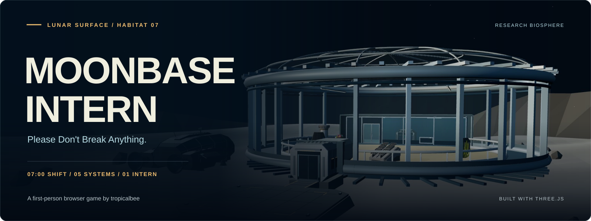

<p align="center">
  
</p>

<h1 align="center">Moonbase Intern</h1>
<p align="center"><strong>Seven minutes. Five systems. One very underqualified intern.</strong></p>
<p align="center">A first-person browser game about keeping a lunar research station alive until handover.</p>

<p align="center">
  <a href="./package.json"></a>
  <a href="./package.json"></a>
  <a href="#4-tech-stack"></a>
  <a href="./LICENSE"></a>
  <a href="#8-project-status"></a>
</p>

<p align="center">
  <a href="https://moonbase-intern.vercel.app/"><strong>Play in your browser</strong></a> &middot;
  <a href="#6-run-locally">Run locally</a> &middot;
  <a href="#5-architecture">Architecture</a> &middot;
  <a href="https://github.com/tropicalbee/Moonbase-Intern/issues">Report a bug</a> &middot;
  <a href="./CONTRIBUTING.md">Contribute</a>
</p>
<p align="center">Created by <a href="https://github.com/tropicalbee"><strong>@tropicalbee</strong></a></p>

## 1. Welcome to Habitat 07

You arrive at a glass-domed research station on the Moon. There are plants under the lights, a rover collecting samples, and equipment that seems unusually willing to introduce itself. Your assignment sounds straightforward: keep the station operational for one shift.

Then the warnings start.

Power, oxygen, lab cooling, communications, and Scout's drive can all develop faults. You have to reach the equipment, read its diagnostic panel, and carry out the repair while the shift clock keeps moving. Later incidents overlap, so deciding what to fix first matters as much as knowing which button to press.

Between alarms, meet Spike the security cactus, Sunny the desert marigold, Moss the tortoise, and the rest of the station. Their dialogue is authored, their opinions are plentiful, and some encounters lead beyond your maintenance checklist.

### What you can do

- **Work a seven-minute shift.** Progress through orientation, pressure, chaos, and a final-minute inspection.
- **Diagnose five systems.** Fifteen repair procedures change the work itself, from isolating a leaking bank to correcting a rover's encoder drift.
- **Practice before the real shift.** Training uses the same repair panels with protected reserves, hints, and repeatable fault variants, without writing a score.
- **Meet the residents.** Looking toward a nearby resident triggers automatic dialogue; remarks also respond to station conditions.
- **Explore between incidents.** Find three optional secrets without losing track of life support.
- **Compare another attempt.** Review your grade, station condition, discoveries, and local personal best; replay the same seed or start fresh.

## 2. Your maintenance route

| System | Service point | Diagnostic work |
| --- | --- | --- |
| **Power** | Watt, the power cell | Isolate tripped feeds, leaking banks, or bus back-feeds; reconnect a suitable supply. |
| **Oxygen** | Capsule, the research pod | Balance flows, bypass a blocked filter, or purge trapped pressure before priming. |
| **Cooling** | Patch, the console inside the lab | Relieve pressure, reopen a blocked return, or calibrate a probe; synchronize the pump. |
| **Communications** | Relay's ground uplink at Watt | Tune frequency and phase; some faults also require relay routing or polarity correction. |
| **Rover** | Scout | Diagnose motor current, brake drag, or encoder error; verify drive recovery. |

Approach and aim at the service point, then press **E when its prompt appears**. Panels show the controls and readings for the current fault. Character conversations happen automatically and do not open equipment service.

Power, oxygen, and cooling failures can terminate a shift early. A stalled rover or offline uplink remains repairable, but both must be restored for handover. **Repairs take active time**; opening a panel does not pause the station.

## 3. Controls and comfort

| Input | Action |
| --- | --- |
| WASD / arrow keys | Move |
| Mouse | Look |
| Shift | Sprint |
| E | Open equipment service when prompted; follow the panel's controls afterward |
| Backspace | Leave an open repair panel |
| Esc | Pause and release the mouse |
| P | Toggle photo pause |
| M | Toggle audio mute |
| R | Restart the shift with a fresh seed; repeat the lesson while training |

Start a shift to capture the mouse. Menu and photo pauses stop active shift time; the game also suspends active play when the tab is hidden or the window loses focus.

Settings include sensitivity, field of view, audio, reduced motion, and rendering quality. **Automatic** adapts rendering resolution to performance; **Low** uses fewer pixels and disables shadows. Desktop keyboard and mouse, WebGL, and mouse capture are required. Touch controls are not implemented.

## 4. Tech stack

| Layer | Technology | Role in the project |
| --- | --- | --- |
| 3D renderer | **Three.js 0.180.0 / WebGL** | Station geometry, lighting, cameras, GLB loading, and raycasting |
| Game logic | **JavaScript ES modules** | System state, incident scheduling, repair diagnostics, scoring, and input |
| Interface | **HTML and CSS** | HUD, equipment panels, dialogue, menus, and shift reports |
| Build tooling | **Vite 8.3.2** | Local development server and static production bundles |
| Development runtime | **Node.js and npm** | Build scripts, release manifests, and verification |
| Models | **GLB / glTF** | Seventeen allowlisted station and character models |
| Audio | **Web Audio API and bundled samples** | Arrival audio, warnings, and gameplay feedback |
| Persistence | **Browser localStorage** | Versioned personal bests, achievements, and recent results |
| Deployment | **Static hosting / Vercel configuration** | A browser-only release with no application server |

There is no account system, backend, or external AI API. The station's dialogue comes from local authored lines.

## 5. Architecture

The application connects the Three.js station to separate modules for equipment rules, repair input, dialogue, training, and results. The following describes how those parts work together in **V1**.

### Reproducible incidents and repairs

[RunPlan.js](./src/game/systems/RunPlan.js) selects a versioned incident plan. [SeededRandom.js](./src/game/systems/SeededRandom.js) combines namespace hashing with a deterministic PRNG, separating timing and diagnostic streams. Plans are generated before play, so frame rate and repair attempts do not consume the schedule's randomness.

V1 includes **13 scheduled incidents** and three repair variants for each of the five systems. [RepairVariants.js](./src/game/systems/RepairVariants.js) generates the evidence and required actions.

To reopen a specific plan locally:

```text
http://127.0.0.1:5173/?seed=LUNA-1234ABCD
```

The seed reproduces the planned incidents and readings. Your decisions still determine the outcome. See [Seeded events](./docs/SEEDED_EVENTS.md).

### Active time and system dependencies

[ShiftSystem.js](./src/game/systems/ShiftSystem.js) coordinates the five equipment models, failure deadlines, and handover. Updates split at scheduled events and deadline boundaries, keeping the rules consistent when frame lengths vary. Rendering, menu time, and active simulation time have separate responsibilities.

Faults also interact: blackout accelerates faulty cooling and prevents pump or uplink verification; oxygen priming increases backup power drain. Those rules make repair order consequential. See [Difficulty and dependencies](./docs/DIFFICULTY.md).

### Interaction and presentation

[InteractionManager.js](./src/game/interactions/InteractionManager.js) checks range and real mesh visibility for targeting. [StationInteractions.js](./src/game/interactions/StationInteractions.js) connects nearby residents, dialogue, and discovery state. World-space speaker anchors, markers, and connectors identify who is talking; repair panels own input while they are open.

Equipment rules live in `*System.js` modules. Their `*Gameplay.js` counterparts connect those rules to input and presentation. [TrainingSession.js](./src/game/training/TrainingSession.js) reuses the actual equipment models in controlled lessons instead of duplicating the repair mechanics.

### Results and local records

[ScoreSystem.js](./src/game/systems/ScoreSystem.js) calculates a terminal report from survival time, repairs, station integrity, discoveries, and outage penalties. [PersonalBests.js](./src/game/systems/PersonalBests.js) stores versioned records locally and handles unavailable or corrupt browser storage. There is no global leaderboard. See [Scoring](./docs/SCORING.md).

### Release integrity

The build creates a fresh release directory and copies only the models in [AssetManifest.js](./src/AssetManifest.js). Its manifest records file sizes and SHA-256 checksums. Verification rejects missing, changed, extra, or unexpected files; the HTTP smoke check also checks served bytes and JavaScript/CSS MIME types.

## 6. Run locally

Use Git, **Node.js 20.19+ on the 20.x line or 22.12+**, matching [package.json](./package.json), and npm.

### Bash (Linux, macOS, or Git Bash)

```bash
git clone https://github.com/tropicalbee/Moonbase-Intern.git
cd Moonbase-Intern
npm ci
npm run dev
```

### Windows PowerShell

```powershell
git clone https://github.com/tropicalbee/Moonbase-Intern.git
Set-Location Moonbase-Intern
npm.cmd ci
npm.cmd run dev
```

Open [http://127.0.0.1:5173](http://127.0.0.1:5173). Stop the server with Ctrl+C. The PowerShell commands use `npm.cmd` to avoid script-policy issues.

If you downloaded a ZIP instead, extract it, open a terminal in the folder containing `package.json`, and start with `npm ci` (`npm.cmd ci` in PowerShell).

## 7. Build and preview

### Bash

```bash
npm run build
npm run verify:release
npm run test:release
npm run preview
```

### Windows PowerShell

```powershell
npm.cmd run build
npm.cmd run verify:release
npm.cmd run test:release
npm.cmd run preview
```

Open [http://127.0.0.1:4173](http://127.0.0.1:4173) to preview the release. These commands do not launch a browser.

| Command | Result |
| --- | --- |
| `npm run build` | Creates and verifies a fresh `dist/releases/public-*` folder. |
| `npm run verify:release` | Rechecks the latest release's manifest, checksums, and asset references. |
| `npm run test:release` | Serves that release on localhost, fetches every packaged file, checks hashes and MIME types, then stops. |
| `npm run preview` | Serves the latest verified release on port 4173. |

`dist/latest-release.txt` identifies the current release. For a static host, upload the **contents of that release folder**, rather than the entire repository. The included Vercel configuration copies the verified release into `vercel-dist/`. See [Public build](./docs/PUBLIC_BUILD.md).

## 8. Project status

**V1.** The game is playable, with all five systems, training, seeded repair variants, dialogue, secrets, and shift reports implemented. Navigation, difficulty, performance, and browser compatibility still benefit from playtesting. Older implementation notes may describe earlier phases; the source defines current behavior.

Built by [@tropicalbee](https://github.com/tropicalbee) as a fun side project while spending time experimenting with GPT models. A little curiosity, a lot of tinkering, and somehow a whole lunar station to look after. Focused fixes, experiments, and feedback are welcome.

## 9. Open source and contributing

Found a bug? [Open an issue](https://github.com/tropicalbee/Moonbase-Intern/issues) with the seed, affected equipment, browser, operating system, and reproduction steps. A screenshot or short recording helps, especially for interaction and rendering problems.

Want to help? Performance work, accessibility, clearer repair feedback, testing on different hardware, and recovering asset attribution are all useful contributions.

- [Contributing guidelines](./CONTRIBUTING.md): how to report a problem, develop a change, and prepare a focused pull request.
- [Code of Conduct](./CODE_OF_CONDUCT.md): expectations for a welcoming project community.
- [Third-Party Notices](./THIRD_PARTY_NOTICES.md): asset credits, library notices, and attribution gaps.
- [Apache 2.0 license](./LICENSE): terms for the original project code.

If the project is useful or you enjoyed your shift, **[star the repository](https://github.com/tropicalbee/Moonbase-Intern)** to support it. **[Fork it](https://github.com/tropicalbee/Moonbase-Intern/fork)** to experiment or contribute your own improvements.

## 10. Credits and license

Original project code is licensed under **Apache 2.0**. Models, audio, and third-party libraries retain their respective licenses. Some original asset sources and permissions still need verification; consult [Third-Party Notices](./THIRD_PARTY_NOTICES.md) before redistributing assets.

The banner uses the game's existing station cover, with SVG typography and shading. Model creator clues include Poly by Google, Quaternius, Zsky, and Dipper98; the attribution record preserves what is currently known without assigning unverified licenses.

---

<p align="center"><strong>Made by <a href="https://github.com/tropicalbee">@tropicalbee</a>, somewhere between curiosity and another repair attempt.</strong></p>
<p align="center"><sub>bro really accepted an unpaid internship on the Moon and still got a performance review.<br>if the cactus starts giving career advice, just hear him out .</sub></p>
