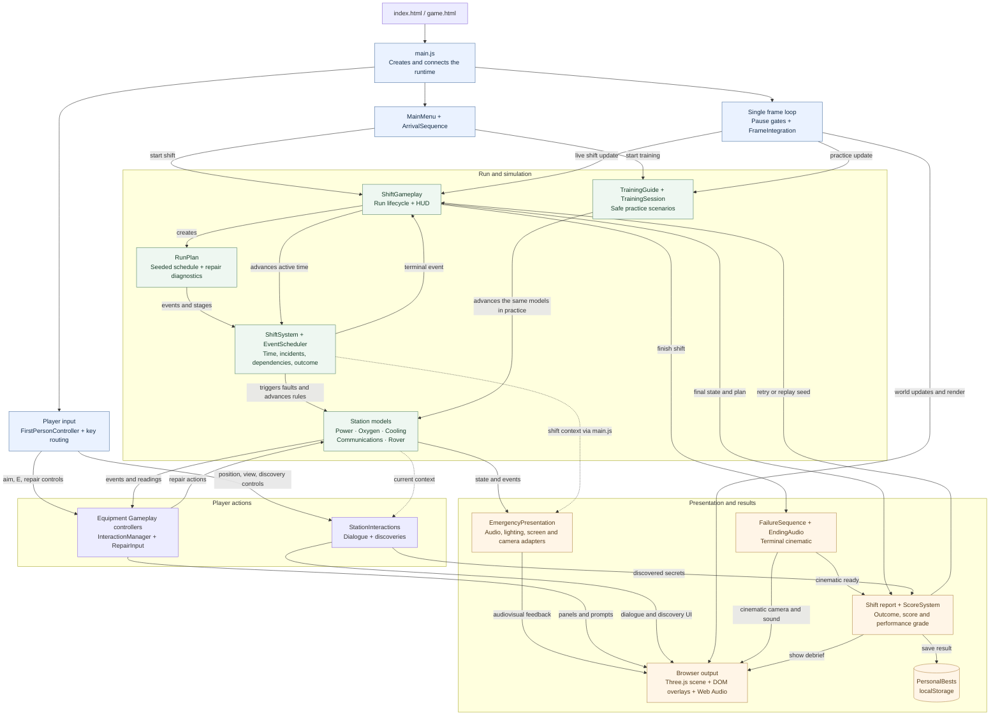

# Architecture

Moonbase Intern runs entirely in the browser. Three.js renders the world, JavaScript models simulate the station, and DOM overlays provide dialogue, repair panels and the shift report. Results are saved locally in the player's browser.

## Runtime overview

Solid arrows show control or data flow; dotted arrows show context read from
current state. The frame loop updates either the live shift or training.
`ShiftSystem` advances the equipment models during a shift; `TrainingSession`
advances those same models during practice. Equipment controllers send repair
actions to the models and update their UI from the resulting state and events.

## Simulation and player actions

[`ShiftGameplay`](../../src/game/systems/ShiftGameplay.js) coordinates the run, clock, ending and report. It creates a seeded run plan and passes the plan's incidents and stages to [`ShiftSystem`](../../src/game/systems/ShiftSystem.js), which advances active time, dispatches faults, applies system dependencies and decides the outcome.

The five station models own power, oxygen, cooling, communications and rover rules. Each model is paired with a `*Gameplay` controller that owns its repair panel, service target and input handling. For example, [`PowerGameplay`](../../src/game/systems/PowerGameplay.js) translates repair choices into [`PowerSystem`](../../src/game/systems/PowerSystem.js) operations. `ShiftSystem` advances all five models during a live shift; controller updates refresh their UI and presentation.

[`InteractionManager`](../../src/game/interactions/InteractionManager.js) checks aim, distance and occlusion before a service target can be used. `main.js` routes keys to the active mode and equipment controller. [`RepairInput`](../../src/game/interactions/RepairInput.js) coordinates pointer lock and the repair cursor. Only one equipment panel can own input at a time.

State stays with its owner: the shift owns its timer and outcome, each equipment model owns its fault and repair progress, and interactions own encounters and discoveries. Presentation reads that state to explain what is happening.

## Seeded runs

[`RunPlan`](../../src/game/systems/RunPlan.js) generates the incident schedule and diagnostics before play. It uses namespaced random streams from [`SeededRandom`](../../src/game/systems/SeededRandom.js), the stage schedule in [`DifficultyPlan`](../../src/game/systems/DifficultyPlan.js), and the procedures in [`RepairVariants`](../../src/game/systems/RepairVariants.js).

[`EventScheduler`](../../src/game/systems/EventScheduler.js) delivers ordered events once; `ShiftSystem` decides how each event affects the models. Player actions and frame rate do not consume the plan's random streams. Normal play selects plan version 8; older versions remain available for replay. The plan factory itself retains version 7 as its default for callers that omit a version.

## Rendering and feedback

[`main.js`](../../src/main.js) constructs the scene, loads models through the shared [`AssetManifest`](../../src/AssetManifest.js), places the station and updates the player, doors and moving actors. Collision uses explicit bounds and colliders alongside the visual geometry.

[`EmergencyPresentation`](../../src/game/presentation/EmergencyPresentation.js) collects model events and derives a shared emergency snapshot from current shift and equipment state. Its adapters turn that snapshot into alarm audio, equipment indicators, lighting, screen effects and temporary camera impacts. These adapters read simulation state; they do not decide faults, repair success or deadlines.

[`StationInteractions`](../../src/game/interactions/StationInteractions.js) coordinates character dialogue, contextual station commentary and discoveries. `DialogueManager` owns the active line's lifecycle; the dialogue UI projects its speaker anchor and places the bubble around HUD obstacles.

## Time and pause behavior

The single frame loop in `main.js` advances movement and simulation before refreshing dialogue, equipment UI and emergency feedback, then renders the scene.

[`FramePacer`](../../src/FramePacer.js) limits rendering while retaining elapsed active time. [`FrameIntegration`](../../src/FrameIntegration.js) divides that time into steps of at most 25 ms. `ShiftSystem` further splits at incident, repair and failure boundaries so deadlines remain consistent across frame rates.

Menu pause, photo pause, focus loss and a hidden document freeze live simulation. An open repair panel can keep simulation running while the player uses its cursor. A frame gap longer than one second triggers a performance pause. Arrival and terminal cinematics temporarily take camera ownership and use their own update branches inside the same frame loop.

## Lifecycle, training and results

The first start runs the arrival sequence before handing control to the player. The shift then runs until a failure or the seven-minute handover. `ShiftGameplay` hands the scene to `FailureSequence` and `EndingAudio`, then reveals the report. Retry starts in the habitat with a fresh seed; Replay Seed preserves the plan.

[`TrainingGuide`](../../src/game/training/TrainingGuide.js) and [`TrainingSession`](../../src/game/training/TrainingSession.js) reuse the equipment controllers and models in guided scenarios. Training protects learning reserves and advances the models in place of `ShiftSystem`; it does not run the live shift scheduler or save a score.

[`ScoreSystem`](../../src/game/systems/ScoreSystem.js) calculates the terminal score and performance grade from the run's actual state. [`PersonalBests`](../../src/game/systems/PersonalBests.js) stores versioned bests, discoveries, achievements and up to ten recent results in `localStorage`. Storage failure falls back to records for the current visit. Settings currently last for the active page. There is no server-side result store.

## Entry and deployment

`index.html` and `game.html` provide the same game shell and load `src/main.js`. Vite bundles both entries. [`scripts/build.mjs`](../../scripts/build.mjs) creates a fresh release folder, copies the allowed models, adds credits and a checksum manifest, verifies the package and updates `dist/latest-release.txt`.

See [public build instructions](../PUBLIC_BUILD.md) for packaging and preview, [seeded events](../SEEDED_EVENTS.md) for replay behavior, and [scoring](../SCORING.md) for score and grade formulas.
